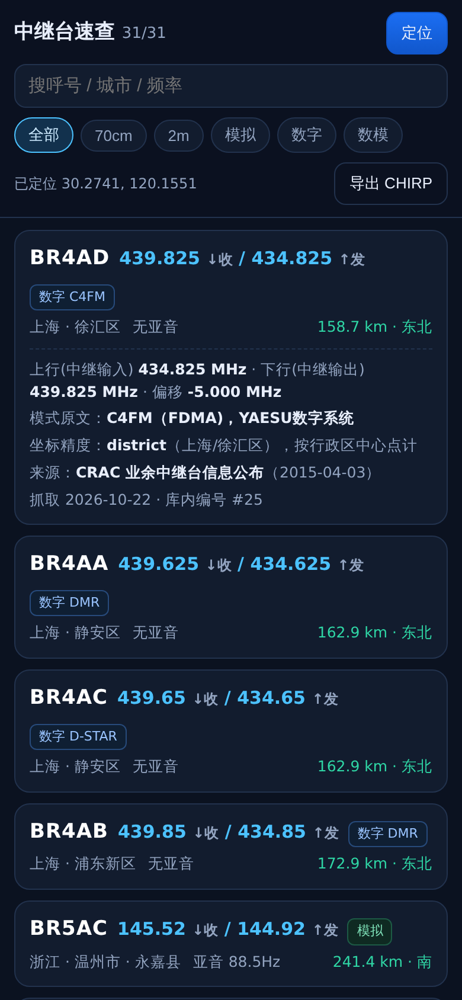
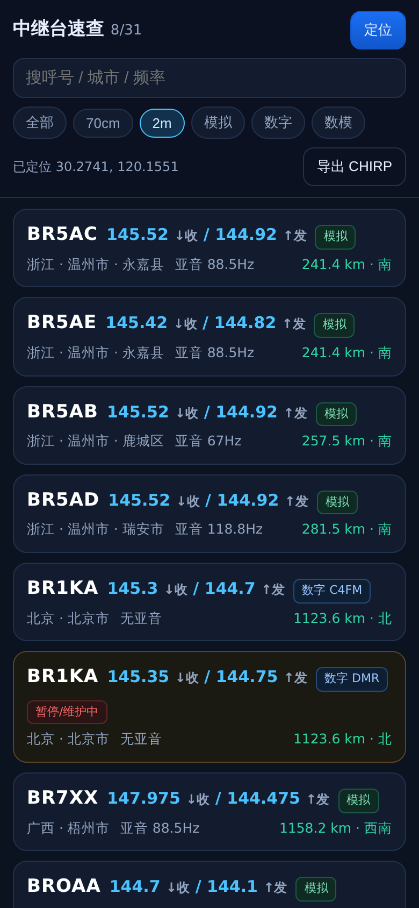
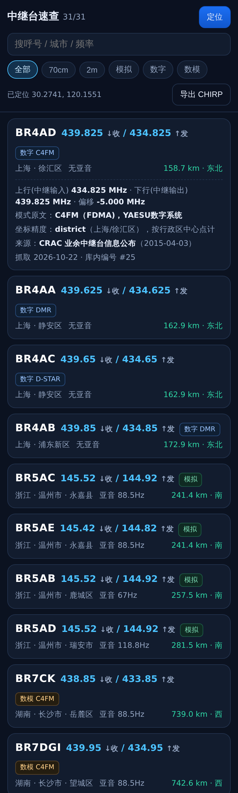

# 中继台速查 · CN Repeater Index

把国内业余无线电中继台的**公开信息**整理成可查、可核对、可离线用的速查工具。

抓取 → 清洗 → 建库 → 网页/接口 → 手机 PWA → 单文件 HTML → CHIRP CSV 导出。

**零依赖**：只用 Python 标准库 + 原生 JS。不需要 pip、npm、数据库服务，一台装了 Python 3.8+ 的机器就能跑。



| | |
|---|---|
|  |  |

## 为什么做这个

网上的中继台列表大多有两个问题：**不知道数据是哪年的**，以及**字段被"补全"过**。

这个工程的设计原则是相反的：

- 每条记录都带 `source_name` / `source_date` / `geo_accuracy`，界面上直接显示来源和原文链接；
- **拿不到的字段就留空**，不做推测补全、不合并来源、不猜台址；
- 每条数据源在 `sources.json` 里写清发布机构、公布日期、引用方式和使用条款；
- 坐标精度分 `district` / `city` / `province` 三级并如实标注 —— 当前用的是行政区中心点，**不是台站真实位置**，距离只适合判断"哪个区更近"。

## 快速开始

```bash
git clone <本仓库地址> cn-repeater-index
cd cn-repeater-index

python3 scripts/build.py              # 联网抓取 → 清洗 → 建库 → 导出 web/data/repeaters.json
python3 scripts/make_single_file.py   # 打包成 dist/中继台速查.html（单文件、双击即用、离线可用）
python3 server.py --port 8787         # 起服务：http://127.0.0.1:8787/
```

想直接看效果：打开 `dist/中继台速查.html`，或下载 [Releases](../../releases) 里的单文件版本（约 45 KB，CSS/JS/数据全内联，任何手机/电脑双击就能打开）。

## 能做什么

- **手机/网页**：定位后按距离排序，显示方位、亚音、模式；点击卡片展开来源与坐标精度；一键导出 CHIRP CSV。
- **单文件**：`dist/中继台速查.html` 完全离线可用，定位与导出照常工作。
- **PWA**：Service Worker 缓存 app shell 和数据，加桌面图标。
- **HTTP 接口**：
  - `GET /api/meta`
  - `GET /api/sources`
  - `GET /api/repeaters?lat=&lon=&radius=&band=&mode=&q=&limit=`
  - `GET /api/export/chirp.csv?...`（同一套过滤参数，返回可直接导入 CHIRP 的 CSV）

## 目录

```
.
├── sources.json              源注册表（URL、发布机构、页面日期、字段映射、引用与警示）
├── scripts/
│   ├── common.py             频率/模式/亚音解析、距离方位、CHIRP 行生成
│   ├── fetch_crac.py         CRAC 行文本源（html_lines）
│   ├── fetch_gov_table.py    政府公开信息表源（html_table，按表头名映射列，不依赖列序）
│   ├── georesolve.py         行政区名 → 经纬度（DataV GeoJSON，带磁盘缓存）
│   └── build.py              管线：抓取→清洗→坐标→SQLite→web/data/repeaters.json
├── web/                      手机端 PWA（index.html / app.js / style.css / sw.js）
├── web/data/repeaters.json   构建产物，随仓库提供以便 clone 后直接起服务
├── tests/                    Python 单测 + Node 冒烟测试 + Playwright 视觉核对
├── server.py                 零依赖 HTTP 服务 + 接口 + CHIRP 导出
└── docs/screenshots/         真机视口截图
```

构建产物（`data/` 缓存与抓取原文、`dist/`）不入库，`python3 scripts/build.py` 可完整重建。
`db/repeaters.sqlite`（52 KB，仅含公开字段）随仓库提供，所以 clone 后不起构建也能直接 `python3 server.py` 看效果。

## 测试与验证

```bash
python3 -m unittest discover -s tests -v     # 解析/几何/CHIRP
node tests/app_smoke.mjs                     # 最小 DOM 桩里真跑 web/app.js
python3 scripts/make_single_file.py
node tests/single_file_smoke.mjs             # 真跑打包产物，抓脚本顺序/依赖错误
```

真跑过的结果（不是"应该能跑"）：

| 项目 | 方式 | 结果 |
|---|---|---|
| Python 单测 | `python3 -m unittest discover -s tests` | **15 项通过**（Ran 15 tests, OK） |
| 前端逻辑 | `node tests/app_smoke.mjs` | **16 项通过**（过滤/排序/方位/CHIRP/渲染，真跑 `web/app.js`） |
| 单文件产物 | `node tests/single_file_smoke.mjs` | **9 项通过**（按 `<script>` 顺序真跑，抓打包顺序错误） |
| 视觉核对 | Playwright + Chromium，390×844 手机视口 | 31 张卡片渲染、定位排序、详情展开、2m 过滤均正常，控制台无错误（截图见 `docs/screenshots/`） |
| CI | GitHub Actions | Python 单测 + 两个 Node 冒烟 + 单文件打包，见 `.github/workflows/ci.yml` |

前端的冒烟测试不是只做语法检查：它在 Node 里用最小 DOM 桩真跑 `web/app.js`，所以过滤、排序、距离方位、导出这些逻辑出问题时会被拦住。

## 数据现状（务必看清）

| 项 | 现状 |
|---|---|
| 条目 | 31 条（去重后），全部有坐标 |
| 来源 | 3 个：CRAC 中继台公布页（26 条）、深圳市工信局 2025-09-04 表（3 条）、深圳市工信局 2026-03-31 表（2 条） |
| 覆盖 | 北京、上海、浙江（温州）、湖南、广东（深圳/佛山）、广西、新疆、山西、宁夏 —— **远不是全国** |
| 时效 | CRAC 该页创建于 **2015-04-03**，很可能长期未更新；深圳两张表分别是 2025-09 与 2026-03 |
| 坐标 | 行政区中心点（GCJ-02，来自 DataV 行政区 GeoJSON），精度分 district / city / province 三级，**不是台站真实位置** |
| 缺失 | 港澳台、绝大多数省份、执照编号、具体台址门牌 |

这是**工具和管线**，不是全国中继台大全。主要工作量在数据面：需要继续接省级无委/通管局公示（多为 HTML 表格或 PDF），而不是写代码。

## 新增一个数据源

1. 在 `sources.json` 里加一条：`id` / `name` / `url` / `publisher` / `kind` / `page_date` / `citation` / `terms` / `freshness_warning`。
   - 政府网页表格用 `"kind": "html_table"`，把表头原文填进 `table_header`，省份填 `province`；
   - 纯文本逐行公布的用 `"kind": "html_lines"`。
2. `python3 scripts/build.py`，看 `[ok] <id>: N 条`。
3. 若解析数为 0，先 `curl` 把页面存到 `data/raw/<id>.html`，再对着它调 `fetch_gov_table.HEADER_MAP` 或 `fetch_crac.LINE_RE`。
4. 坐标只在行政区一级，无需逐个台站补；若某地只公布到"市"，会自动退到 city 精度并如实标注。

## 已知限制

- 数据面远未完成（见上表）。代码部分基本没有遗留问题。
- 距离基于行政区中心点，**不能当地图测距用**。
- PWA 离线包已做（Service Worker 缓存 app shell + 数据），但首次访问需能联到服务端。
- 视觉核对脚本需要 Playwright 的 Chromium：
  ```bash
  pip install playwright && python -m playwright install chromium
  python3 server.py --port 8787 &
  python3 tests/visual_check.py
  ```

## 合规与引用

- 只抓取公开发布的信息，保留发布机构、发布时间与原文链接；不用于商用、不做数据售卖。
- CRAC 明确其汇总仅接受设台机构/技术负责人经官方渠道提交的信息，本工程只做原文聚合展示，不修改、不推测、不补全缺失字段。
- 使用提示：《业余无线电台管理办法》（2024-03-01 施行）第七条口径——A 类业余电台可工作于 30–3000 MHz 范围内划分给业余业务的频率，最大发射功率不大于 25 W。跨区使用以当地公示与实际参数为准。
- 频率与亚音请以当地无线电管理机构最新公示为准，本工具不构成操作依据。

## License

MIT，见 [LICENSE](LICENSE)。
